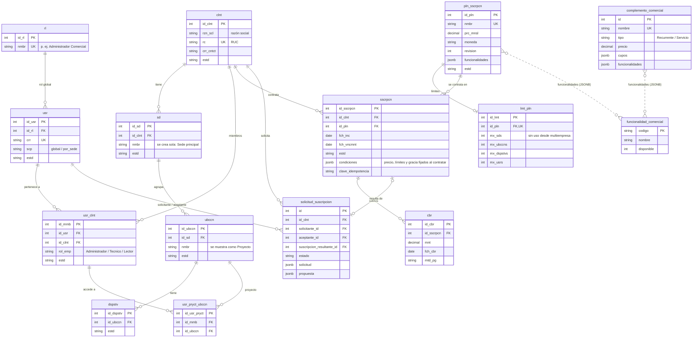
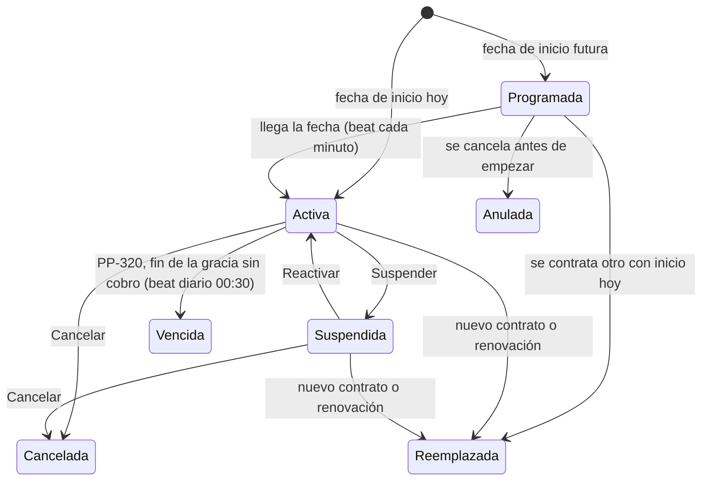

# Modelo comercial: diagrama entidad-relación (PP-322)

Modelo de datos comercial de Pangea después del flujo multiempresa (commit `b948aac`)
y de PP-320/PP-321. GitHub dibuja el diagrama Mermaid directamente.

## Reglas que el diagrama no muestra

- **Una empresa (`clnt`) tiene a lo sumo un contrato `Activa` y uno `Programada`**
  (índices únicos parciales `uq_sscrpcn_clnt_activa` y `uq_suscripcion_programada`).
- **Los cupos se cuentan por empresa**, sumando todas sus sedes: proyectos (`ubccn`),
  dispositivos y usuarios. Se validan con `comprobar_cupo()` en
  `app/services/limites_plan.py`, con los límites guardados en `sscrpcn.condiciones`
  y no con los del plan actual, para que editar el catálogo no cambie un contrato vigente.
- **La sede es un detalle interno.** El primer proyecto de una empresa crea la
  «Sede principal» (`_resolver_sede` en `routers/ubicaciones.py`); por eso `lmt_pln.mx_sds`
  ya no se usa como cupo.
- `pryct` y las tablas de permisos `prms_usr_sd` y `prms_ubccn` se conservan como
  histórico o para usuarios antiguos, y no se dibujan.

## Estados de `sscrpcn.estd`

Además del estado guardado, `estado_contrato()` calcula lo que ve el usuario según la fecha:
**Vigente** (hasta `fch_vncmnt`), **En gracia** (hasta `fch_vncmnt + dias_gracia`) y
**Vencida** (después). Al vencer, la empresa queda en modo consulta: ve su histórico y la
telemetría se sigue recibiendo, pero no puede crear recursos.

PP-320 deja guardado ese «Vencida» cuando no hay cobro registrado en `cbr` y PP-321 avisa
por correo a los usuarios activos con rol «Administrador Comercial»
(`app/tasks/suscripciones.py` y `app/tasks/notificaciones.py`).
