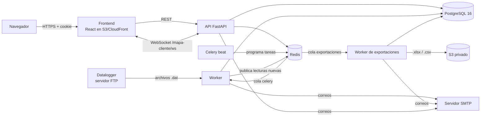
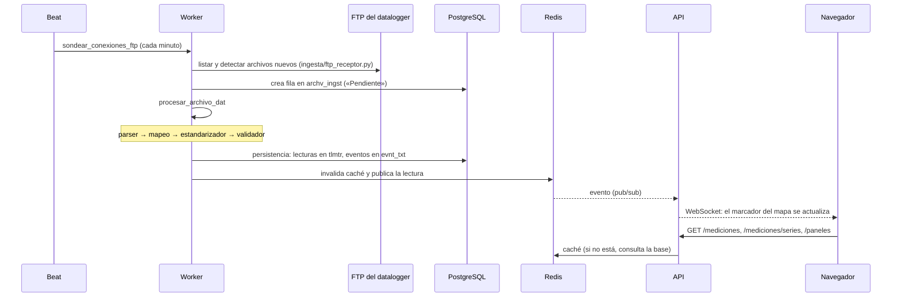
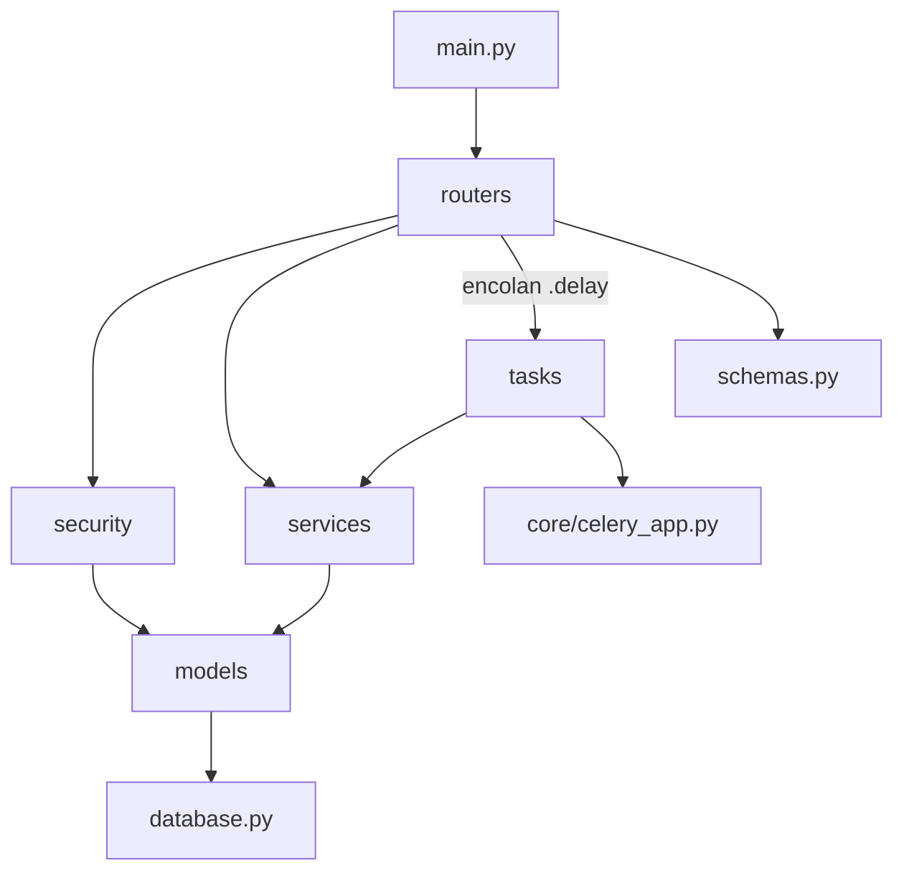
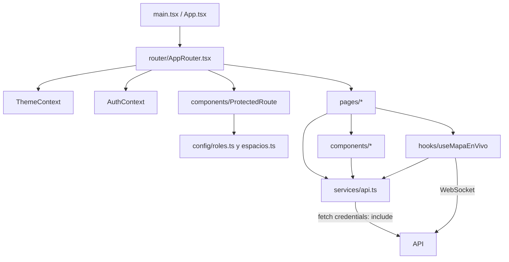

# Guía de módulos y dependencias

Mapa del código de Pangea 4.0 para quien llega nuevo: qué hace cada módulo,
de qué depende y por dónde entrar para cambiarlo. Para levantar el proyecto,
ver el [`README.md`](../README.md); para las decisiones técnicas de cada
HU/HT, [`backend/README.md`](../backend/README.md).

Estado: rama `dev` al 02/11/2026 (commit `f9c0967`).

## 1. Piezas en ejecución

| Pieza | Arranca con | Qué hace |
|---|---|---|
| API | `uvicorn app.main:app` | Endpoints REST, WebSocket del mapa, login con cookie |
| Worker | `celery -A app.core.celery_app worker` | Ingesta FTP, correos, suscripciones |
| Worker de exportaciones | `... worker --queues=exportaciones --concurrency=1` | Genera los archivos de exportación (HT-17), aparte para no frenar la ingesta |
| Beat | `celery -A app.core.celery_app beat` | Dispara las tareas programadas (tabla de abajo) |
| Redis | `docker compose up -d redis` | Broker de Celery, caché, límite de login, eventos del mapa, tickets de WebSocket |
| PostgreSQL | `docker compose up -d db` | Todos los datos; `tlmtr` particionada por mes |

Tareas programadas (`backend/app/core/celery_app.py`):

| Tarea | Cada cuánto | Para qué |
|---|---|---|
| `ingesta.sondear_conexiones_ftp` | 1 min | Revisa cada conexión FTP según su frecuencia y encola los `.dat` nuevos |
| `ingesta.reencolar_pendientes_atascados` | 30 min | Vuelve a encolar archivos «Pendiente» de más de 15 min |
| `particiones.asegurar_particiones_futuras` | diario, 03:00 | Crea con anticipación las particiones mensuales de `tlmtr` |
| `suscripciones.activar_suscripciones_programadas` | 1 min | Activa las suscripciones cuya fecha de inicio llegó |
| `exportaciones.mantener_exportaciones` | 1 min | Vence exportaciones y limpia archivos caducados |

## 2. Flujo principal: de un archivo `.dat` a la pantalla

Paso por paso, en `backend/app/services/ingesta/`:

1. `parser.py`: convierte el texto del `.dat` en filas
   `{columna: valor}`. No conoce marcas de sensor. Rechaza el archivo
   completo si el encabezado parece corrupto (I-27).
2. `mapeo.py`: decide qué formato (`mp_frmt`) aplica al dispositivo y cómo
   se traduce cada columna a un parámetro (`prmtr`). Si una columna no
   tiene mapeo, queda en `mp_clmn_pendiente` (HU49 a HU51).
3. `estandarizador.py`: aplica ese mapeo y produce la estructura interna
   común.
4. `validador.py`: descarta valores o filas inválidas **sin detener** el
   resto del archivo.
5. `persistencia.py`: guarda en `tlmtr` (numéricos) y `evnt_txt` (textos)
   y avisa a la caché.

Cada intento queda en `intnt_prcsmnt`; la pantalla «Cola de ingesta»
(HU09, HU31) muestra pendientes, en proceso, fallidos y reprocesos.

## 3. Backend por capas

Regla general: `routers` → `security` y `services` → `models` →
`database`. Los `tasks` usan `services` y nunca a los `routers`. Las
excepciones están en la [sección 5](#5-dependencias-que-conviene-conocer).

### 3.1 Routers (`app/routers/`): la API

| Archivo | Prefijo | HU/HT | Qué expone | Depende de |
|---|---|---|---|---|
| `auth.py` | `/auth` | HU01, HU02 | Login con cookie httpOnly (8 h), logout, «Mi perfil», recuperar contraseña, ticket de WebSocket | `security.jwt_auth`, `hashing`, `password_policy`, `mailer`, `ws_tickets`, `services.contratos` |
| `usuarios.py` | `/usuarios` | HU03, HU04, HU20, HU21 | Listar, crear, editar usuarios y sus permisos | `security.auditoria`, `permisos`, `services.limites_plan`, `tasks.notificaciones` |
| `empresas.py` | `/empresas` | multiempresa | Proyectos y usuarios aislados por cliente | `security.entorno`, `services.limites_plan` |
| `comercial.py` | `/comercial` | PP-47 | Planes, límites y asignación de suscripciones | `services.contratos`, `limites_plan` |
| `solicitudes_suscripcion.py` | `/solicitudes-suscripcion` | PP-47 | Ampliaciones pedidas por la empresa | `routers.comercial`, `services.contratos` |
| `ubicaciones.py` | `/ubicaciones` | HU07, HU08, HU22 | CRUD de ubicaciones (en pantalla: «proyectos») y su mapa | `services.cache`, `limites_plan` |
| `dispositivos.py` | `/dispositivos` | HU10, HU18, HU19 | Dataloggers: listar, ficha, activar/desactivar, estadísticas | `services.ingesta.mapeo`, `particiones`, `cache.invalidacion`, `tasks.ingesta` |
| `conexiones_ftp.py` | `/conexiones-ftp` | HU05 | Conexión FTP de cada datalogger y «Probar conexión» | `security.ftp_crypto` |
| `mapeos.py` | `/mapeos`, `/parametros`, `/sedes`, `/mapeos/dispositivos` | HU06, HU49-51, DEC-09 | Formatos de archivo, columnas y parámetros; vista previa de un `.dat` | `services.ingesta.parser`, `validador`, `visualizacion`, `tasks.ingesta` |
| `ingesta.py` | `/ingesta` | HU09, HU31, HT-05 | Cola de procesamiento, métricas, reintentos | `ingesta.ftp_receptor`, `services.ingesta.*`, `tasks.ingesta` |
| `mediciones.py` | `/mediciones` | HU12-HU16, HU32 | Telemetría filtrada por parámetro, ubicación y fechas | `services.cache`, `downsampling`; monta `series_mediciones.py` |
| `series_mediciones.py` | `/mediciones/series` | paneles | Series por datalogger, formato y parámetro | `services.visualizacion` |
| `mapa_cliente.py` | `/mapa-cliente` | HU17 | Carga inicial del mapa y WebSocket en vivo | `services.mapa.*`, `security.ws_tickets` |
| `panel.py` | `/paneles` | HU23-HU25 | Tableros personalizables con widgets | `services.mapa.semaforo`, `ultimos_valores`, `contratos` |
| `exportaciones.py` | `/exportaciones` | HU33, HT-17 | Pedir, listar y descargar exportaciones | `services.exportaciones`, `exportaciones_storage`, `tasks.exportaciones` |
| `auditoria.py` | `/auditoria` | HT-11 | Consulta del log de auditoría (solo lectura) | `security.permisos` |

Todos los routers usan `database.get_db` y `models`. `/health` y `/` están
en `main.py`.

### 3.2 Seguridad (`app/security/`)

| Archivo | Qué hace |
|---|---|
| `jwt_auth.py` | Emite y valida el JWT (variable `JWT_SECRET`) |
| `dependencies.py` | `Depends` que devuelve 401 si falta la sesión o está vencida |
| `permisos.py` | `require_permiso(modulo, LECTURA/EDICION)`: permisos por módulo según `prms_usr_sd` y el rol en la empresa |
| `entorno.py` | Alcance operativo: qué cliente y proyectos puede tocar el usuario |
| `ubicaciones_permitidas.py` | CENERIS ve todas las ubicaciones; el resto, solo las asignadas (HU21) |
| `auditoria.py` | Escribe en `lg_adtr` los cambios de usuarios y permisos (HT-11) |
| `hashing.py`, `password_policy.py` | bcrypt y la regla de 8 caracteres, 1 mayúscula y 1 número |
| `ftp_crypto.py` | Cifra y descifra las contraseñas FTP con Fernet (`FTP_CREDENTIAL_KEY`) |
| `ws_tickets.py` | Tickets de un solo uso para abrir el WebSocket del mapa |
| `mailer.py` | Envía correos por SMTP; sin SMTP, los deja en el log |

### 3.3 Servicios (`app/services/`)

| Módulo | Qué hace | Lo usan |
|---|---|---|
| `ingesta/` | Parser, mapeo, estandarizador, validador y persistencia (sección 2); `usuario_sistema.py` da el usuario «Sistema» para auditar lo automático | `tasks.ingesta`, `routers.ingesta`, `mapeos`, `dispositivos` |
| `cache/` | `consultas.py` (caché Redis de respuestas, base 5), `downsampling.py` (reduce series largas a máx. 2000 puntos), `invalidacion.py` (borra la caché al llegar datos) | `routers.mediciones`, `ubicaciones`, `mapa_cliente`, `services.ingesta.persistencia` |
| `mapa/` | `ultimos_valores.py` (último valor por estación), `semaforo.py` (color por antigüedad del dato; umbrales provisionales hasta HU28), `eventos.py` (pub/sub Redis, base 4) | `routers.mapa_cliente`, `panel`, `tasks.ingesta` |
| `contratos.py` | Condiciones comerciales y derechos efectivos de cada empresa | `routers.auth`, `comercial`, `panel`, `security.permisos`, `tasks.suscripciones` |
| `limites_plan.py` | Consumo contra los cupos del plan (ubicaciones, dispositivos, usuarios) | casi todos los routers de administración |
| `particiones.py` | Crea particiones mensuales de `tlmtr` | `tasks.particiones`, `services.ingesta.persistencia`, `routers.dispositivos` |
| `visualizacion.py` | Cómo se muestra cada columna (unidad, tipo); no infiere eventos | `schemas.py`, `routers.mapeos`, `series_mediciones` |
| `exportaciones.py`, `exportaciones_storage.py` | Reglas y límites de exportación; subida a S3 privado y URL firmada | `routers.exportaciones`, `tasks.exportaciones` |

### 3.4 Tareas (`app/tasks/`)

| Archivo | Tareas | Cola |
|---|---|---|
| `ingesta.py` | `sondear_conexiones_ftp`, `procesar_archivo_dat`, `reencolar_pendientes_atascados` | `celery` |
| `exportaciones.py` | `generar_exportacion` (cola propia), `notificar_exportacion`, `mantener_exportaciones` | `exportaciones` / `celery` |
| `notificaciones.py` | `enviar_correo_bienvenida` (al crear un usuario) | `celery` |
| `particiones.py` | `asegurar_particiones_futuras` | `celery` |
| `suscripciones.py` | `activar_suscripciones_programadas` | `celery` |
| `ping.py` | `ping`, para comprobar que el worker responde | `celery` |

### 3.5 Modelos (`app/models/`)

Las tablas se nombran en español abreviado sin vocales (ver
[`CONTRIBUTING.md`](../CONTRIBUTING.md)). Las principales:

| Grupo | Tablas (modelo) |
|---|---|
| Usuarios y permisos | `usr` (Usuario), `rl` (Rol), `prms_usr_sd` (PermisoUsuarioSede), `prms_ubccn` (permiso por ubicación), `tkn_rcprcn` (token de recuperación), `lg_adtr` (auditoría) |
| Empresas | `clnt` (Cliente), `sd` (Sede, interna), `pryct` (Proyecto), `usr_clnt`, `usr_pryct_ubccn` |
| Comercial | `pln_sscrpcn` (plan), `lmt_pln` (límites del plan), `sscrpcn` (suscripción), `cbr` (cobro), `funcionalidad_comercial`, `complemento_comercial`, `solicitud_suscripcion` |
| Exportaciones | `exprtcn` |
| Parámetros calculados | `prmtr_clcld` |
| Dispositivos | `ubccn` (Ubicación), `dspstv` (Dispositivo), `cnxn_ftp` (ConexionFTP) |
| Formatos | `mp_frmt`, `mp_clmn`, `mp_clmn_pendiente`, `prmtr` |
| Ingesta | `archv_ingst`, `intnt_prcsmnt` |
| Telemetría | `tlmtr` (particionada por mes sobre `fch_hr`), `evnt_txt` |
| Paneles | `pnl`, `pnl_ubccn`, `wdgt` |
| Alarmas | `alrm`, `cndcn_alrm`, `dstntr_alrm`, `ntfccn_envd` (modelo creado; la funcionalidad es de una HU futura) |

## 4. Frontend

| Pantallas (`pages/`) | Endpoints que usan |
|---|---|
| `Login`, `OlvideContrasena`, `RestablecerContrasena`, `MiPerfil` | `/auth` |
| `PanelAdmin`, `PanelTecnico`, `PanelComercial`, `PanelUsuario`, `PanelEntorno` | resúmenes: `/empresas`, `/usuarios`, `/ubicaciones`, `/dispositivos`, `/comercial`, `/mapa-cliente` |
| `Usuarios`, `Empresas`, `Clientes` | `/usuarios`, `/empresas`, `/ubicaciones` |
| `PlanesSuscripciones` (y `components/comercial/`) | `/comercial`, `/solicitudes-suscripcion` |
| `Ubicaciones`, `DetalleUbicacion`, `MapaUbicacionesPage` | `/ubicaciones`, `/sedes`, `/dispositivos` |
| `Dispositivos`, `DispositivoDetalle`, `ConexionesFTP` | `/dispositivos`, `/conexiones-ftp`, `/mapeos`, `/parametros`, `/sedes` |
| `Parametros`, `ColaIngesta` | `/parametros`, `/ingesta` |
| `ConsultaDatos`, `Graficos` (y `ExportacionesPanel`) | `/mediciones`, `/mediciones/series`, `/ubicaciones`, `/dispositivos`, `/exportaciones` |
| `MapaEstacionesPage` | `/mapa-cliente` (REST y WebSocket) |
| `Paneles`, `DetallePanel` | `/paneles`, `/mediciones`, `/mediciones/series` |

Dependencias externas del frontend: `react-router-dom` (rutas),
`@react-google-maps/api` (mapas, necesita `VITE_GOOGLE_MAPS_API_KEY`),
`framer-motion` (animaciones) y Tailwind.

## 5. Dependencias que conviene conocer

- **`services.contratos` y `services.limites_plan` se importan entre sí.**
  `limites_plan.py` importa `contratos` arriba del archivo, y `contratos.py`
  importa `limites_plan` **dentro** de sus funciones, para evitar un import
  circular al cargar. No muevas esos imports al inicio de `contratos.py`.
- **`routers.solicitudes_suscripcion` importa `routers.comercial`.** Es la
  única dependencia entre routers. Si se reutiliza más lógica, conviene
  moverla a `services/`.
- **`schemas.py` importa `services.visualizacion`.** Cambiar
  `visualizacion.py` puede cambiar las respuestas de la API.
- **La caché depende de la ingesta.** Si una lectura entra sin pasar por
  `services/ingesta/persistencia.py` (por ejemplo, una carga manual por
  SQL), hay que invalidar la caché a mano o esperar el TTL.
- **`FTP_CREDENTIAL_KEY` y `JWT_SECRET` deben ser iguales** en la API, el
  worker y beat. Si difieren, el worker no puede descifrar las contraseñas
  FTP.
- **El worker de exportaciones es un proceso aparte.** Sin él, las
  exportaciones quedan en cola para siempre.
- **El permiso «Catalogo» se guarda como «Ingesta»** en `prms_usr_sd`
  (`security/permisos.py`).
- **La zona horaria de Celery es `America/Bogota`** (UTC-5, igual que
  Lima). El frontend muestra las fechas en la zona del usuario (HU14).

## 6. Por dónde empezar según la tarea

| Quiero... | Mira primero |
|---|---|
| Agregar un endpoint | `routers/` del módulo, `schemas.py`, `security/permisos.py`, un test en `tests/routers/` |
| Soportar un formato de datalogger nuevo | `services/ingesta/mapeo.py`, pantalla `Parametros`, «Cargar un formato nuevo» en `backend/README.md` |
| Cambiar una tabla | `models/`, una migración nueva en `alembic/versions/` |
| Agregar una tarea periódica | `tasks/`, `beat_schedule` en `core/celery_app.py` |
| Agregar una pantalla | `pages/`, `router/AppRouter.tsx`, `config/espacios.ts`, `components/layout/Sidebar.tsx` |
| Entender por qué algo es así | El docstring del archivo (casi todos citan la HU/HT y el criterio) y `backend/README.md` |
